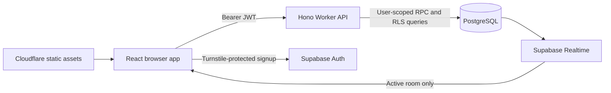

# peak. — Peak Unemployment

**No job? You've got company.** An anonymous social break room for the in-between era: public industry rooms, consent-based private conversations, small wins, and a little humor.

This repository contains a React/Hono application, PostgreSQL migration, RLS policies and tests. **It is not deployed.** No real credentials are committed. Live Supabase signup, hosted Realtime, email recovery and cloud deployment require configuration and live verification; the app does not fabricate success when these services are missing.

## Implemented

- Responsive Midnight Liquid Glass landing page with lazy R3F/Drei bubble scene, CSS fallback and reduced-motion support; clearly labeled fictional chat preview.
- Real Supabase anonymous-auth integration with Turnstile, generated unique identity, editable nickname, configurable industry/profession choices, optional onboarding steps and DM requests off by default.
- Global lounge plus eight industry rooms, persisted message API, active-room Realtime subscriptions, cursor history, reactions, own-message deletion, pending/failed retries, connection states and scroll controls.
- Private request/accept/decline flow, approved conversations, read state, close controls, blocking and reporting. Consent and permissions are enforced in PostgreSQL, not only the UI.
- Profile/settings, three themes, motion preference, blocked-user management, optional email linking/recovery, explicit sign-out warning and account/data deletion.
- Moderator allowlist, report queue with reported content, removal/restriction controls and private metrics from actual application data.
- Atomic persistent rate limits, duplicate/link restrictions, strict request schemas, verified bearer tokens, RLS, isolated Auth identifiers and security headers.
- Unit, React component, Worker and real PostgreSQL integration tests; public browser tests and a separate opt-in live two-session suite; CI and operations documentation.

## Quick start

Use Node 24.13+ and npm:

```sh
npm ci
npm run dev
```

Open the URL printed by Vite (normally `http://127.0.0.1:5173`). Without credentials, the public website works and joining shows the required setup state.

For a live installation, copy `.env.example` → `.env` and `.dev.vars.example` → `.dev.vars`, enter your own values, then restart Vite. [Deployment instructions](docs/deployment.md) document every variable, Supabase anonymous auth, Turnstile, email linking, local development and Cloudflare secrets.

## Supabase setup

Create a dedicated free project, enable anonymous sign-in and Turnstile CAPTCHA in Supabase Auth, configure redirect URLs, then apply the schema:

```sh
npx supabase login
npx supabase link --project-ref YOUR_PROJECT_REF
npx supabase db push --include-seed
```

The migration creates the schema, grants and RLS; the seed creates nine rooms. The Turnstile **secret goes into Supabase Auth settings**, while its site key goes into Vite. The server-only Supabase secret is needed for deleting one's account. See [database operations](docs/database.md) for local Docker setup, admin grants, schema details and data retention.

## Stack and architecture

React, Vite, strict TypeScript, Tailwind CSS, shadcn-style Radix components, Lucide, React Router, TanStack Query, Motion, Three.js/R3F/Drei; Hono on Cloudflare Workers; Supabase Auth/PostgreSQL/Realtime; Zod, Vitest, React Testing Library, PGlite and Playwright. Installed compatible versions are pinned in `package.json` and `package-lock.json`.



Public profile IDs are separate from Auth UUIDs. All table writes go through transaction functions with server-derived identity. No always-running Node server, AI API or paid service is required. Read [architecture](docs/architecture.md) and [security](docs/security.md) for the boundaries and tradeoffs.

## Project structure

```text
src/
  react-app/
    components/
      chat/ChatPanel.tsx
      layout/Shell.tsx
      profile/PersonDialog.tsx
      three/Bubbles.tsx
      ui/{button,dialog}.tsx
      {common,Turnstile}.tsx
    contexts/{session,preferences}.tsx
    hooks/useMessages.ts
    lib/{api,utils}.ts
    pages/{Landing,Join,Room,Messages,Settings,Recover,Admin,Legal}.tsx
    App.tsx
    main.tsx
    styles.css
  worker/
    routes/{profile,chat,social,admin}.ts
    index.ts
    lib.ts
  shared/{config,schemas,types}.ts
supabase/
  migrations/202611020001_initial.sql
  seed.sql
  config.toml
tests/
  unit/{core.test.ts,button.test.tsx,chat.test.tsx}
  integration/{api,database}.test.ts
  e2e/{public,live}.spec.ts
docs/{architecture,database,security,deployment,verification}.md
public/_headers
.github/workflows/ci.yml
.env.example
.dev.vars.example
components.json
package.json
package-lock.json
vite.config.ts
vitest.config.ts
playwright.config.ts
tsconfig.json
wrangler.jsonc
```

## Tests

```sh
npm run typecheck
npm run lint
npm test
npm run build
npx playwright install chromium
npm run test:e2e
npm audit
```

The SQL tests execute the real migration in a local PostgreSQL WASM engine with Auth fixtures. They test RLS and permission failures; they do not emulate or claim to verify hosted Realtime. The live Playwright suite is skipped unless `LIVE_E2E=1` and a separate test project is configured. It creates and cleans up test accounts and uses actual signup, REST and realtime—not mock message delivery. See [the test instructions](docs/deployment.md#checks-and-live-verification).

Local results are recorded in [verification.md](docs/verification.md). CI runs lint, types, unit/integration tests, production build and default browser checks without production secrets.

## Deploy to Cloudflare

After setting Vite build variables and completing live verification:

```sh
npx wrangler login
npx wrangler secret put SUPABASE_URL
npx wrangler secret put SUPABASE_PUBLISHABLE_KEY
npx wrangler secret put SUPABASE_SERVICE_ROLE_KEY
npm run deploy
```

This deploys frontend assets and `/api/*` in one Worker application. No deployment was performed during implementation. Add the final domain to Supabase redirects and Turnstile allowed hostnames. [Deployment and rollback details](docs/deployment.md#cloudflare-deployment) include CI secrets, CSP, analytics and rollback boundaries.

## Screenshots

Actual local screenshots: [desktop landing](docs/screenshots/landing-desktop.png), [mobile landing](docs/screenshots/landing-mobile.png), and [honest setup state](docs/screenshots/join-desktop.png). The browser suite also writes fresh screenshots to ignored `test-results/`. After live verification, add selected real screenshots here:

- [ ] Desktop lounge with test accounts
- [ ] Mobile chat and composer
- [ ] Consented private conversation

No live usage screenshots, deployment links or member statistics are invented.

## Known limits and next steps

1. Connect an isolated Supabase project and Turnstile, run the live journey, verify recovery email and CAPTCHA failure cases, then deploy only after review.
2. Add the operator's privacy/moderation contact, review legal text, and define retention before a public launch.
3. The UI keeps at most 400 loaded messages per view. Inbox lists/requests and admin reports are bounded to 100 entries. Requests cannot be resent after decline; closed conversations cannot be reopened. These are intentional MVP boundaries, not silently advertised features.
4. Unread counts outside the active DM refresh on inbox navigation/focus. No typing indicators, presence, background all-room subscriptions, uploads or AI processing.
5. Message bodies are not end-to-end encrypted. Blocking hides content and prevents new interactions but cannot retract content already delivered. Account deletion removes shared conversations too; provider backup/log retention is separate.
6. The heavy Three.js bundle is lazy-loaded and absent from chat. Font loading uses Google Fonts with local system fallback; self-host fonts if your privacy/deployment policy requires it.
7. Measure actual database latency, concurrent RLS/Realtime fan-out, Worker CPU, abuse volume and quotas. A target of 500–1,000 registrations is not a guarantee of concurrent-user capacity. The [free-tier limits and scaling plan](docs/deployment.md#free-tier-planning) explain the constraints.

AI remains disabled (`AI_ENABLED=false`); curated daily prompts work without a model. Potential later work includes finer-grained Broadcast delivery, data-retention jobs, per-user archives, additional moderation audit tooling and OAuth linking. Core functionality should remain available if any future AI provider is unavailable.

## Honest portfolio metrics

Only moderators see counts. Registered users means created public profiles; active users means distinct **public message senders** in the trailing 24 hours/30 days, not page views or all logged-in users. The query also reports persisted public messages and per-room message totals; deleted accounts reduce historical counts. Private message contents never enter analytics.

After actual usage, report measured numbers with the definition and date: “Built and deployed an anonymous realtime social platform with X registered profiles and Y distinct public senders in the last 30 days.” Replace X/Y only with actual data. Optional Cloudflare Web Analytics is off until a real beacon token is configured.
