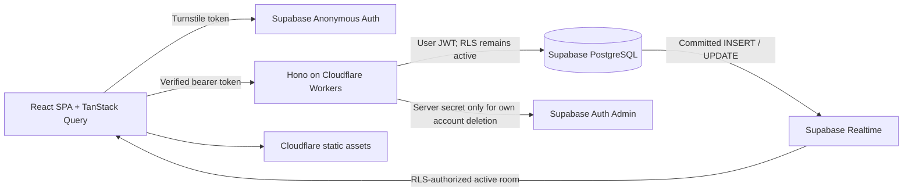

# Architecture

The app uses the official Cloudflare Vite plugin, React SPA assets and a Hono API on `/api/*`. There is no always-on Node server. Hono's standard Request/Response interface keeps it portable; a Node adapter and replacement asset hosting would be needed for a move.

## Frontend

The homepage is chat-first and server-rendered with meaningful public copy. Public room history is fetched separately; no message bodies enter the HTML template. The interactive React app loads after the first paint; member chat, join, settings and other private screens are lazy chunks. Missing credentials produce a truthful unavailable-service state. There is no fictional production feed.

`SessionProvider` uses Supabase Auth and bootstraps an idempotent public profile via the Worker. The SQL function creates a random public UUID independent from `auth.users.id`. A private mapping is not exposed to clients. Nicknames have a case-insensitive uniqueness constraint.

There are no 3D effects on the homepage. Space Grotesk and Inter are self-hosted WOFF2 fonts. Light and dark modes use shared CSS tokens, with reduced-motion and opt-in message-announcement preferences.

## Data and mutation boundary

The Worker calls `auth.getUser(token)` rather than trusting decoded claims. It uses a publishable key plus the caller's JWT for normal data operations. Zod validates requests, limits request bodies, and rejects supplied sender/role fields. The service-role key is used only for deleting the caller's own Auth account.

Authenticated clients receive SELECT privileges with RLS, but no direct table-write privileges. Security-definer mutation functions use an empty search path, derive the caller through `auth.uid()`, lock state, and enforce consent, author ownership, blocking, length, link, duplicate and rate rules. Those checks also cover direct calls to Supabase's RPC API. Server timestamps and unique `(sender_id, client_id)` keys make network retries idempotent.

The one SQL mutation entry point groups transactional actions; Hono routes are separated into profile, chat, social and administration modules. Shared schemas/configuration live outside both runtimes.

## Realtime and history

For a small MVP, Postgres Changes is intentionally simpler than custom Broadcast authorization. Only the active room/conversation message filter is subscribed. Inbox request and conversation metadata subscriptions exist only on the messages screen, filtered for the current user. All subscriptions are removed on unmount.

INSERT/UPDATE notifications trigger a coalesced, authoritative API refetch. Message bodies are persisted before delivery. Reactions touch their parent message timestamp so the same active-message subscription refreshes reaction counts. Soft deletion erases content and publishes an UPDATE. Raw DELETE subscriptions are avoided because Supabase has different filtering/authorization behavior for DELETE events.

History uses a `(created_at, id)` cursor and 40-row pages. The UI retains at most ten pages (400 messages) per room view to bound rendering; reopening returns to the newest page. Within that window it preserves scroll position for older pages and offers a new-message button when scrolled up. Cached delivered content cannot be “unseen”; hard account deletion is reflected on the next refetch. No presence, typing broadcasts, or all-room subscriptions are used.

Unread counts are one bounded SQL query, not one API subrequest per conversation. The active visible conversation updates its read cursor after rendering near the bottom. Other conversations' unread counts refresh when opening/focusing the inbox; no background all-DM message subscriptions are used.

## Deliberate MVP tradeoffs

- Pending request pairs are unique for their lifetime, including declines. This prevents repeated harassment; re-request/reopen controls are not included.
- Either participant can close a conversation for both people. History remains readable until blocking/deletion. Per-user archive and reopening are future work.
- Consent-changing operations use a short transaction advisory lock; message rate counters lock the sender profile. This favors correctness at modest traffic, not unlimited throughput.
- API and DB rate limits are per account; CAPTCHA and Supabase Auth limits reduce account farming, but no anonymous service is immune to determined abuse.
- Reports review the specifically reported message only. No moderator browsing of arbitrary private conversations is implemented.
- Curated prompts rotate daily in UTC. `AI_ENABLED` is false. A future Workers AI service should be an isolated, disabled-by-default adapter, with bounded calls and curated fallback. No private text may be sent without a separate disclosed opt-in design.

## Sources consulted

- [Cloudflare React + Vite](https://developers.cloudflare.com/workers/framework-guides/web-apps/react/)
- [Cloudflare Hono](https://developers.cloudflare.com/workers/framework-guides/web-apps/more-web-frameworks/hono/)
- [Supabase anonymous authentication](https://supabase.com/docs/guides/auth/auth-anonymous)
- [Supabase CAPTCHA](https://supabase.com/docs/guides/auth/auth-captcha)
- [Supabase Postgres Changes](https://supabase.com/docs/guides/realtime/postgres-changes)
- [Supabase RLS](https://supabase.com/docs/guides/database/postgres/row-level-security)

## Guest reading

GET `/api/public/rooms/:slug/messages` precedes authentication middleware. It calls `guest_room_feed` with only the publishable key and no visitor bearer token. Anonymous database roles receive EXECUTE on this one projection, not table SELECT or mutation privileges. The projection excludes private conversations, Auth IDs, profile IDs, DM preferences and reaction user IDs. Public message IDs are returned for stable rows and cursors.

Guests poll the active visible room every 15 seconds, pause polling offline/in background, and retain at most four 30-message pages. The endpoint advertises a 10-second shared cache lifetime. Actual CDN caching and origin load must be measured after deployment; the browser does not assume every request hits an edge cache. No guest Auth creation, presence or Realtime channels. Signed-in subscriptions keep their existing RLS checks. Blocking remains effective between authenticated accounts; publicly visible posts remain readable while logged out.

## Public HTML and search

The Worker renders the homepage, industry room descriptions, and information pages from shared React components. Its asset binding fetches `/` rather than `/index.html` to avoid HTML canonicalization redirects. Private routes emit noindex in headers and metadata. Unknown pages return HTTP 404. Robots and sitemap contain public informational routes; chat APIs are noindex/nosnippet and live feed regions use data-nosnippet. This discourages indexing; it does not make deliberately public posts confidential or prevent copying.
